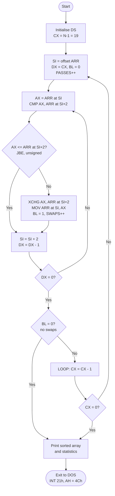

# Bubble Sort on the Intel 8086

**Aim:** Sort an array of twenty 16-bit unsigned numbers in ascending order using the Bubble Sort algorithm, in 8086 assembly language.

| Path | What it is |
|---|---|
| `src/BUBBLE.ASM` | The program. MASM / TASM / emu8086 syntax. |
| `simulator/index.html` | Interactive step-by-step simulator of the sort routine. Open it in any browser. |
| `docs/SAMPLE_OUTPUT.txt` | The exact screen the program prints for the built-in data. |
| `tests/` | Automated tests: assemble for the 8086 and run in a CPU emulator. |

---

## 1. Running the program

**emu8086 (most labs)**
1. *File → Open* → `src/BUBBLE.ASM`
2. Click **Emulate**, then **Run**.
3. Press `1` for the built-in numbers or `2` to type your own 20 numbers.

**MASM + LINK (DOSBox or real DOS)**
```
MASM BUBBLE.ASM;
LINK BUBBLE.OBJ;
BUBBLE
```

**TASM + TLINK**
```
TASM BUBBLE.ASM
TLINK BUBBLE.OBJ
BUBBLE
```

At start-up the program asks for a data source:

* `[1]` uses the 20 numbers declared in `ARR`.
* `[2]` reads 20 numbers from the keyboard, in decimal from 0 to 65535. **Backspace** deletes a digit. A key that is not a digit, or a digit that would push the number past 65535, is refused with a beep.

It then prints the array before and after sorting, in decimal and in hex, along with the number of passes, comparisons and swaps. Finally it checks that the result really is in ascending order.

---

## 2. Algorithm

Bubble sort compares neighbouring elements and swaps them when they are out of order. After pass *k*, the *k* largest values are in their final places at the end of the array, so each pass can stop one element earlier. If a pass makes no swaps, the array is already sorted and the program stops early.

```
CX ← N − 1                               ; comparisons in the first pass
repeat
    SI ← offset ARR ; DX ← CX ; BL ← 0     ; start of a pass
    repeat DX times
        if ARR[SI] > ARR[SI+2] (unsigned)
            exchange ARR[SI], ARR[SI+2] ; BL ← 1
        SI ← SI + 2                        ; next word
    if BL = 0 then stop                    ; no swap → already sorted
    CX ← CX − 1
until CX = 0
```

### Flowchart



---

## 3. The sort routine

```asm
BUBBLE_SORT PROC
            MOV  CX, N-1                ; first pass: N-1 comparisons
OUTER:      MOV  SI, OFFSET ARR         ; j = 0
            MOV  DX, CX                 ; inner counter = CX
            XOR  BL, BL                 ; swapped = 0
            INC  PASSES
INNER:      MOV  AX, [SI]               ; AX = ARR[j]
            INC  COMPS
            CMP  AX, [SI+2]             ; compare with ARR[j+1]
            JBE  NO_SWAP                ; unsigned: ARR[j] <= ARR[j+1]
            XCHG AX, [SI+2]             ; ARR[j+1] = old ARR[j]
            MOV  [SI], AX               ; ARR[j]   = old ARR[j+1]
            MOV  BL, 1                  ; swapped = 1
            INC  SWAPS
NO_SWAP:    ADD  SI, 2                  ; next word (2 bytes)
            DEC  DX
            JNZ  INNER
            OR   BL, BL                 ; any swap in this pass?
            JZ   SORTED                 ; no -> already sorted
            LOOP OUTER                  ; CX = CX-1, next pass
SORTED:     ...
```

(The full routine also saves and restores AX, BX, CX, DX and SI with `PUSH` and `POP`.)

### Register usage

| Register | Role |
|---|---|
| `CX` | Comparisons in the current pass, and the outer loop counter for `LOOP` |
| `DX` | Inner loop counter |
| `SI` | Pointer to `ARR[j]`. It goes up by 2 because each element is a word. |
| `AX` | Holds `ARR[j]` for the compare and the exchange |
| `BL` | Swap flag for the pass. Still 0 at the end of a pass means the array is sorted. |
| `DS` | Data segment, loaded from `@DATA` at start-up |

### Why `JBE` and not `JLE`

The numbers are **unsigned**. After `CMP`:

* `JBE` / `JA` look at **CF and ZF**. That is the unsigned test.
* `JLE` / `JG` look at **SF, OF and ZF**. That is the signed test. It reads `8000h`–`FFFFh` as −32768 to −1, so 65535 would be placed before 0.

The simulator has a **JBE / JLE** switch that shows this mistake happening.

### Other 8086 points used

* `XCHG reg, mem` swaps a register and a memory word in one instruction. There is no memory-to-memory move on the 8086, so one value goes through `AX`.
* `LOOP` decrements `CX` and jumps if `CX ≠ 0`, without changing any flags.
* Words are stored **little-endian**: `0F2A1h` sits in memory as `A1 F2`.
* `ROL BX, CL` with `CL = 4` is used for hex output, because the 8086 can only rotate by an immediate count of 1.
* `AAM` splits a number below 100 into two decimal digits when the element number is printed.

---

## 4. Data and result

Built-in array (`ARR`). It deliberately includes 0, 1, 65535 and values on both sides of 8000h:

```
ARR DW 0F2A1H, 0034H, 9C40H, 1234H, 0FFFFH, 0000H, 7D00H, 2710H, 03E8H, 8000H
    DW 0ABCDH, 0001H, 4E20H, 0C350H, 0063H, 5A5AH, 1388H, 0EA60H, 00FFH, 3039H
```

Program output (from `docs/SAMPLE_OUTPUT.txt`):

```
  BEFORE SORTING
   DEC : 62113    52 40000  4660 65535     0 32000 10000  1000 32768
         43981     1 20000 50000    99 23130  5000 60000   255 12345
   HEX : F2A1H 0034H 9C40H 1234H FFFFH 0000H 7D00H 2710H 03E8H 8000H
         ABCDH 0001H 4E20H C350H 0063H 5A5AH 1388H EA60H 00FFH 3039H

  AFTER SORTING (ASCENDING)
   DEC :     0     1    52    99   255  1000  4660  5000 10000 12345
         20000 23130 32000 32768 40000 43981 50000 60000 62113 65535
   HEX : 0000H 0001H 0034H 0063H 00FFH 03E8H 1234H 1388H 2710H 3039H
         4E20H 5A5AH 7D00H 8000H 9C40H ABCDH C350H EA60H F2A1H FFFFH

  STATISTICS
   Passes       :    15
   Comparisons  :   180
   Swaps        :    99
   Verification : array is in ascending order
```

### Complexity for N = 20

| Case | Passes | Comparisons | Swaps |
|---|---|---|---|
| Best (already sorted) | 1 | 19 | 0 |
| Worst (reverse order) | 19 | 190 = N(N−1)/2 | 190 |
| Built-in data | 15 | 180 | 99 |

Time is O(n²) in the worst and average case. Because of the early exit, it is O(n) in the best case. Extra space is O(1), since the array is sorted in place.

---

## 5. Simulator

Open `simulator/index.html` in a browser. It needs no install and no server.

It executes the real `BUBBLE_SORT` instructions, at the real offsets with the real machine code, one at a time, and shows:

* the source listing, with the next instruction highlighted. Click a line to set a **breakpoint**.
* the array as bars, with the `SI` / `SI+2` pointers, the pair being compared, swapped cells, and the part that is already sorted
* a plain-English explanation of what each instruction just did
* all registers (with `AH`/`AL` etc.), the 9 flags, and which ones changed
* a **memory dump** of `DS:0000`, little-endian, highlighting the bytes read or written
* the **stack** with the saved registers and the return address
* counters: passes, comparisons, swaps, instructions, **clock cycles** and time at 5 MHz (from the Intel 8086 timing tables)
* a **pass history** table and the exact **DOS screen** the program prints

Controls: **Step** `→`, **Back** `←`, **Next compare** `C`, **Finish pass** `P`, **Run/Pause** `Space` (with speed slider), **Run to end** `E`, **Reset** `R`. You can enter your own 20 numbers (decimal, `1234H` or `0x1234`) or use the presets: assignment data, random, worst case, best case, nearly sorted, duplicates, and values above and below 8000h.

---

## 6. Testing

`tests/test_bubble.py` checks the actual `BUBBLE.ASM`:

1. Translates it to NASM syntax (`tests/masm2nasm.py`).
2. Assembles it with `cpu 8086`. This rejects any instruction newer than the 8086 and any conditional jump that is out of range.
3. Runs it in the Unicorn CPU emulator in 16-bit real mode, answering its `INT 21h` calls.
4. Compares the printed arrays and statistics with a Python reference. The cases are the built-in data, sorted, reversed, all equal, 0/65535 pairs, 7FFFh/8000h pairs, keyboard editing (bad key, backspace, overflow, empty Enter), and 300 random arrays.

```
pip install unicorn
python3 tests/test_bubble.py      # needs nasm on PATH
```

---

## 7. Viva questions

**Why is `SI` increased by 2?**
Each element is a word (`DW`), which is 2 bytes.

**Why `JBE` instead of `JLE`?**
The data is unsigned. `JBE` tests CF/ZF, which is unsigned; `JLE` tests SF/OF, which is signed.

**Why go through `AX` to swap?**
The 8086 has no memory-to-memory move. `XCHG AX,[SI+2]` followed by `MOV [SI],AX` swaps the two words using one register.

**What does `LOOP OUTER` do?**
`CX ← CX − 1`. If `CX ≠ 0`, it jumps to `OUTER`. No flags change.

**Why does each pass make one comparison fewer?**
After pass *k*, the *k* largest values are already in their final places at the end.

**What is the swap flag for?**
If a whole pass makes no swap, the array is sorted. Stopping there gives O(n) on sorted input.

**How many comparisons are there in the worst case?**
19 + 18 + … + 1 = 190 = N(N−1)/2.

**How is `0F2A1h` stored in memory?**
As `A1 F2`. The 8086 is little-endian, so the low byte is at the lower address.

**Why the leading 0 in `0F2A1H`?**
The assembler would otherwise read `F2A1H` as a label name. A hex constant must start with a digit.

**What does `MOV AX,@DATA` / `MOV DS,AX` do?**
It loads the data segment address into DS. A segment register cannot be loaded with an immediate value directly.
